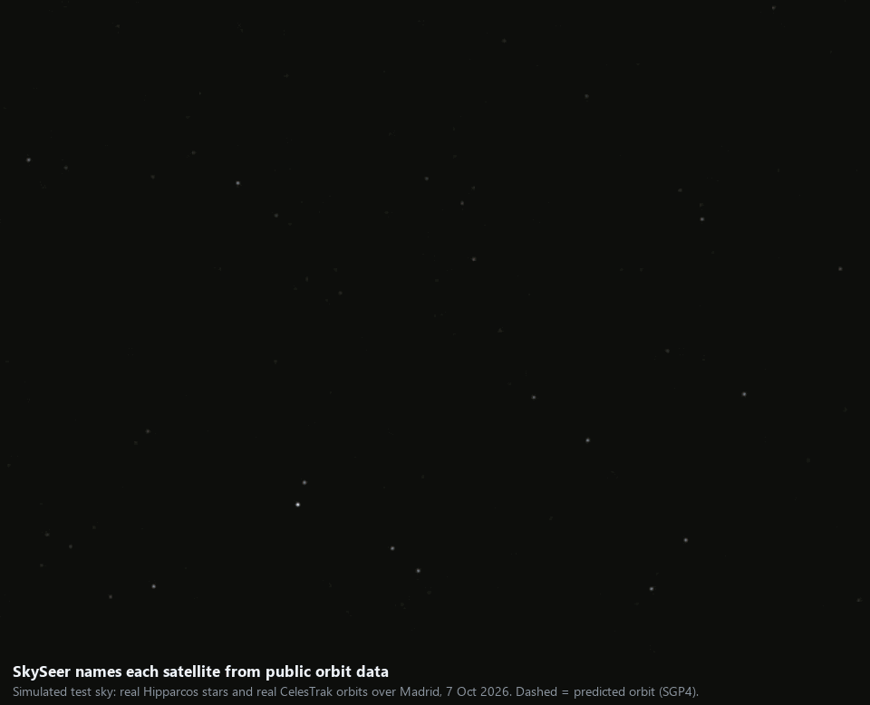
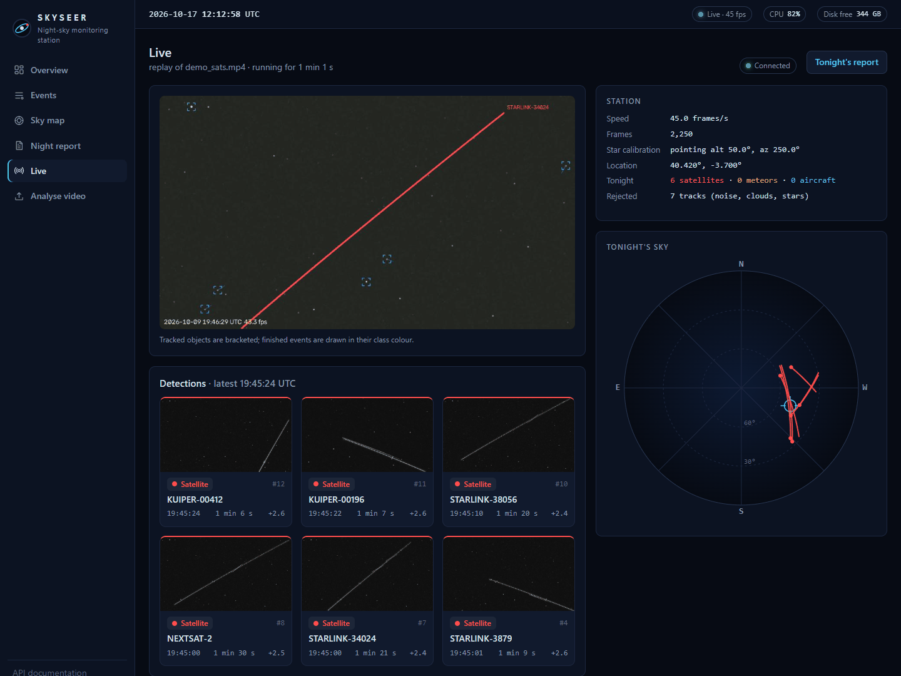
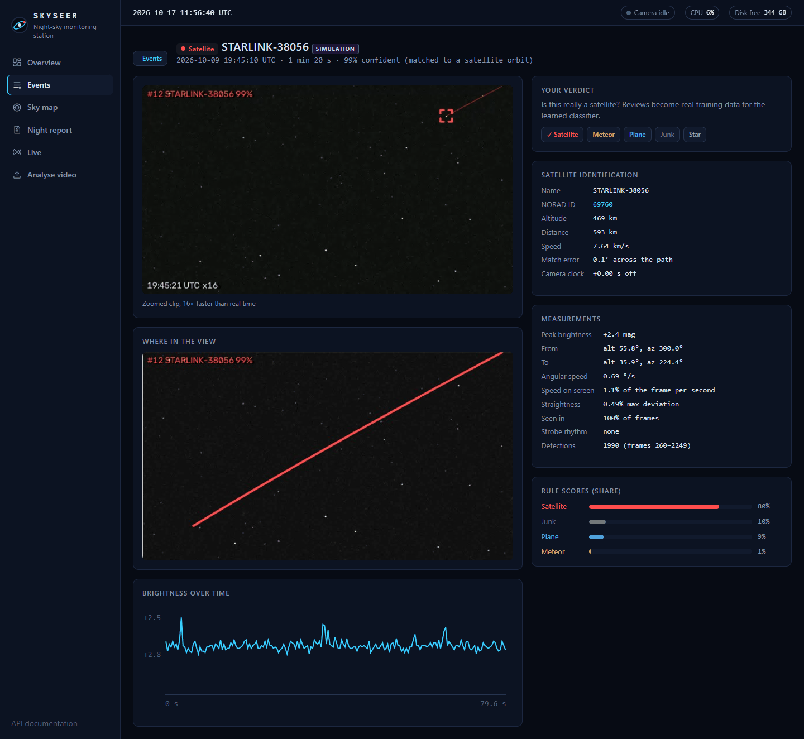
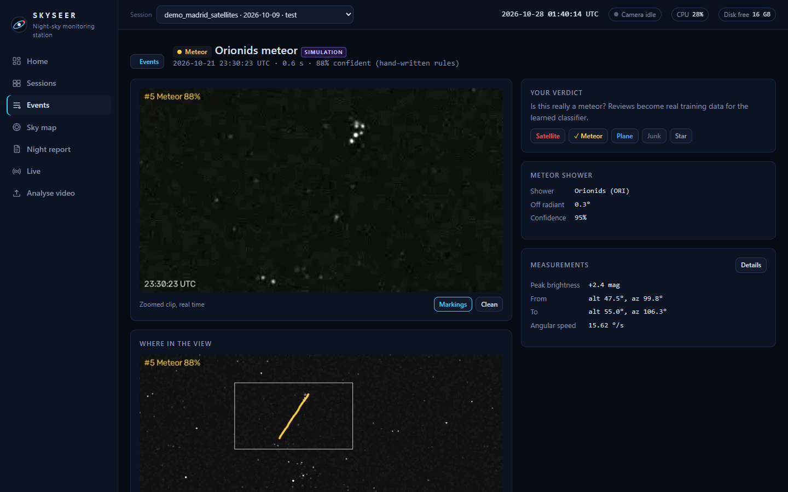
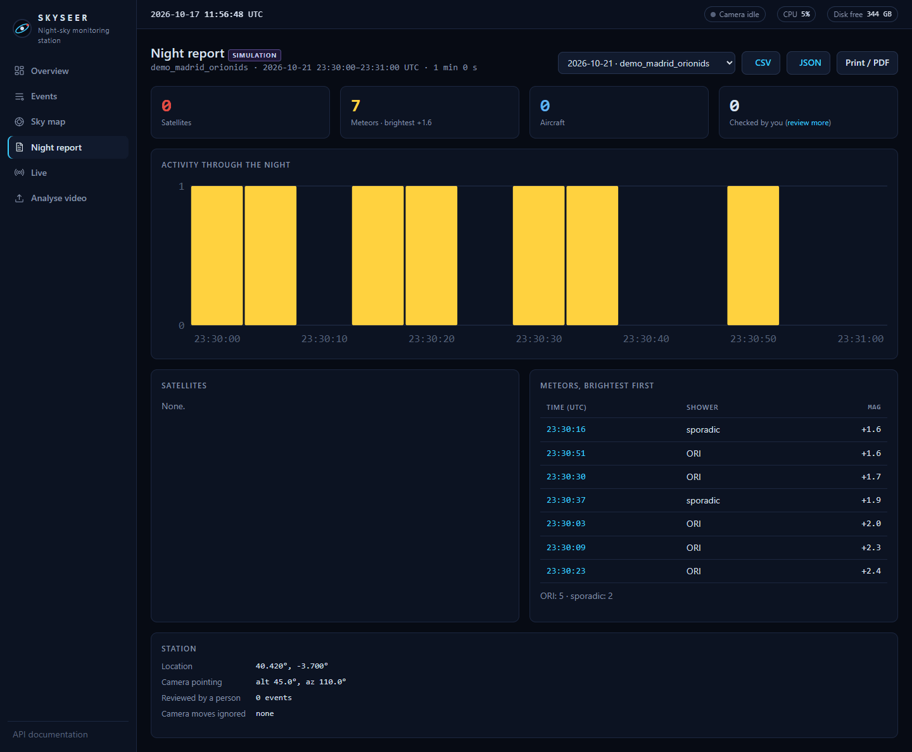
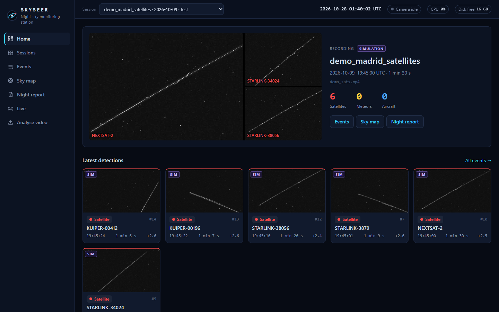
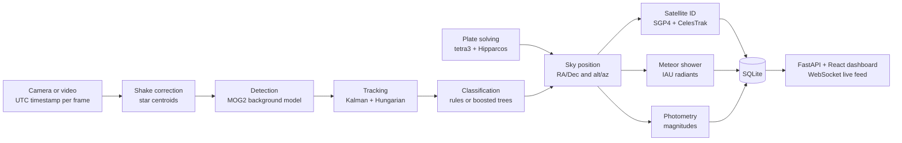
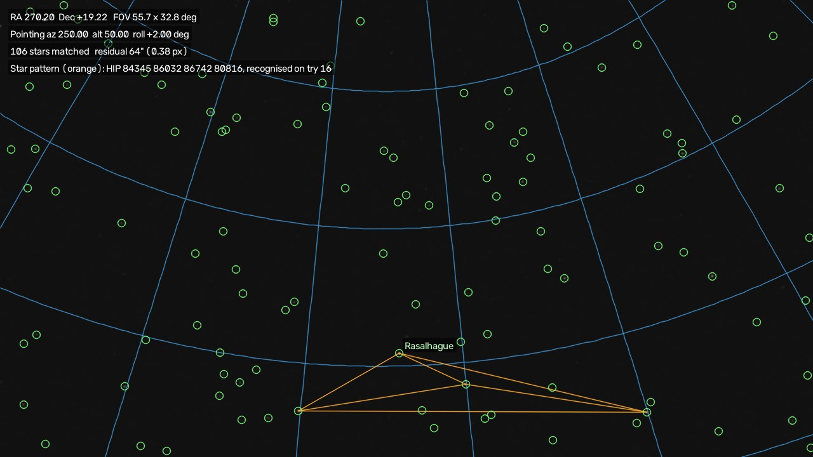
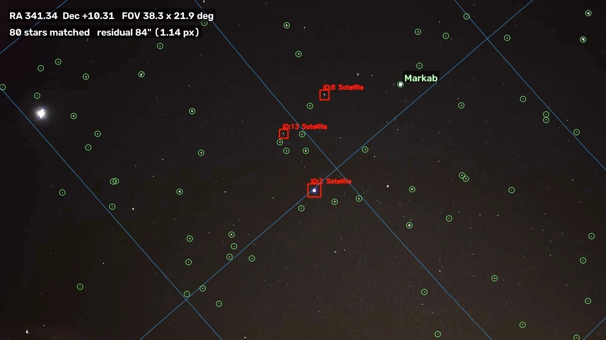

<div align="center">

# SkySeer

### A night-sky monitoring station that detects satellites, meteors and aircraft, works out where its camera points from the stars, and names each satellite from public orbit data.

[](https://github.com/IkerSimarro/SkySeer/actions/workflows/ci.yml)
[](https://python.org)
[](https://opencv.org/)
[](https://fastapi.tiangolo.com/)
[](https://react.dev/)
[](LICENSE)



<sub>SkySeer's own output on a simulated test sky built from real data: real catalogue stars, and real satellites placed where their published orbits put them over Madrid.</sub>

</div>

---

SkySeer turns a fixed camera into a small **space situational awareness** station. It
finds anything that moves across the night sky and works out what it is: a satellite, a
meteor or an aircraft. It then names it:

- **Satellites:** the catalogue object it is, with its height, speed and distance.
- **Meteors:** the shower it belongs to, and its brightness in magnitudes.
- **Aircraft:** the flight broadcasting from that spot (ADS-B), with its height and speed.

To do this it recognises the star pattern in the image, like a spacecraft star tracker,
so it knows exactly where every pixel points in the sky. It then compares each path with
where every catalogued satellite should be at that moment.

It works on recorded video today. It is built to run unattended on a **Raspberry Pi 5
with the HQ camera**: the software is ready and tested, and the station build is planned
for December 2026.

## What it can do

| Capability | Measured result |
|---|---|
| **Star calibration (plate solving)**: recognises the stars with ESA's star-tracker algorithm (tetra3) and the Hipparcos catalogue. It needs no location, time or pointing hint, and also fits the lens distortion. | pointing within 15″ on 30 simulated skies; 80 stars matched on the author's own footage |
| **Satellite identification**: predicts where ~16,000 public satellites are (SGP4 orbit model, CelesTrak data) and matches each observed path. It also measures the camera's clock error. | 6/6 satellites named in simulated passes; 0 of 300 random paths falsely named |
| **Meteor science**: shower association against the IAU list, brightness calibrated from catalogue stars, fireball alerts, and spotting tumbling satellites from their flashes. | ~96% of shower meteors assigned correctly; brightness within ±0.1 magnitude |
| **Detection and tracking**: background modelling, plus a Kalman filter with optimal assignment. It works as a stream, so each event is reported as soon as the object leaves the view, with a zoomed clip and trail image. | 100% found, 100% classified, 0 false alarms on the benchmark |
| **Camera-shake correction**, star-tracker style: the image offset is measured from star positions and removed. | 0.05 px accuracy in 0.7 ms per frame; false alarms from a 4 px wobble 416 → 0 |
| **Classification**: hand-written rules by default. An optional machine-learning model is trained on simulated nights and tested honestly against real footage. | the model wins in simulation (96.7% vs 69.5%) but loses on real footage, so the rules stay the default |
| **Mission-control dashboard**: live camera view, event pages, all-sky map, night reports, and review buttons whose answers become training data. Uploaded recordings are analysed in the background at low priority, and can be stopped and resumed. | a 1080p30 recording analysed at about its own speed (30-34 frames/s) |
| **Aircraft identification**: matches each path against the positions aircraft broadcast (ADS-B), from the free OpenSky Network or a local receiver, the same way as satellites. | 150/150 simulated flights named among 20 others; 0 of 90 false paths named |
| **Unattended station**: observes from dusk to dawn, takes position and time from GPS, starts itself at boot and cleans up its own disk. | Sun position within 0.012° of NASA JPL's ephemeris |

## The dashboard



<sub>The Live page during a replay of a simulated night: each satellite appears with its
name as soon as it leaves the view, and its path is added to the all-sky map. Simulated
data is tagged SIMULATION everywhere in the dashboard.</sub>

| A satellite | A meteor |
|:---:|:---:|
|  |  |
| Named from its orbit: NORAD ID, height, range, speed, how well the path matched, and the camera's clock error. | Matched to the Orionid shower's radiant, with its calibrated brightness through the flight. A **Clean** switch hides the box and trail. |

<details>
<summary>More: night report and home page</summary>




<sub>One session switcher in the top bar drives every page. Sessions can be renamed and
removed (optionally with their files) on the Sessions page; test sessions from the
simulators are hidden unless asked for.</sub>

</details>

## How it works



1. **Frames.** Every frame carries a UTC timestamp, from the video's metadata, a given
   start time, or (on the Pi) the camera sensor's own clock.
2. **Shake correction.** About 60 bright stars are located to a fraction of a pixel in
   each frame. Their median shift is the camera's wobble, which is undone. A real move or
   knock is detected and handled separately.
3. **Detection.** A per-pixel statistical model of the background (OpenCV MOG2) flags what
   changed. Blobs are measured by pixel count, so 1–2 px objects survive, with
   brightness-weighted centroids for sub-pixel positions.
4. **Tracking.** Each object has a constant-velocity Kalman filter, whose prediction
   bridges gaps of up to 3 s while a faint satellite fades. Detections are assigned to
   tracks optimally (the Hungarian algorithm), and two crossing objects stay apart.
5. **Classification.** Rules use measurements that don't depend on the camera: speed in
   image diagonals per second, path straightness, how regularly a strobe flashes (aircraft
   flash 40–100 times a minute), and the cloud texture around the object.
6. **Plate solving.** tetra3 takes groups of 4 bright stars, turns each group's shape
   into a code (the ratios of the 6 distances between them) and looks it up in a database
   built from Hipparcos (118,000 stars). SkySeer records the pattern that was recognised,
   and after how many tries, and draws it on the calibration overlay. The camera's
   orientation comes from Wahba's problem solved with an SVD, the classic spacecraft
   attitude method. Lens distortion is then fitted against the full catalogue. Guards
   against false solutions reject random dots and impossible lenses.

   

   <sub>The Madrid test sky (simulated from real catalogue stars): the 4-star pattern
   tetra3 recognised (orange, on the 16th group it tried) and the 106 catalogue stars then
   matched (green).</sub>
7. **Satellite identification.** The whole catalogue is propagated with SGP4 at once
   (~40 ms for 16,000 objects). Each observed path is compared with each candidate's
   predicted path. The **sideways** distance between them is insensitive to a wrong
   camera clock, so it identifies the satellite. The **along-track** offset then measures
   how far off the clock is. Ambiguous cases, such as Starlink trains, get reduced
   confidence, and orbits too old for the recording date are refused rather than guessed.
8. **Meteors.** A path is traced backwards to the radiants of active showers. Its angular
   speed must match what the shower's entry velocity predicts for that geometry.
   Magnitudes come from a photometric zero point measured on catalogue stars in the same
   image.
9. **Aircraft.** Airliners broadcast their GNSS position, height, speed and flight
   number (ADS-B). SkySeer turns each broadcast position into a direction in the
   camera's sky (WGS84 coordinates to the local horizon) and matches paths with the same
   sideways-and-timing test as satellites. A live station asks OpenSky only while
   something crosses the view, to stay within its free daily allowance, and names a pass
   once the broadcasts after it have arrived. A match outranks the motion rules: a
   broadcasting aircraft really was there.

## Results

Every number below has a test, a benchmark or a recorded experiment behind it.

| What | Result | How it was measured |
|---|---|---|
| Detection and classification | 100% of 100 objects found, 100% classified correctly, 0 false alarms, ~130 frames/s | 20 synthetic scenes with known truth, re-run on every change (`tools/validate.py`) |
| Camera pointing from the stars | ≤ 15″ error on 30 of 30 skies; random-dot images never accepted as a sky | simulated skies rendered from the Hipparcos catalogue at random places, times and lenses |
| Real-sky plate solving | author's own footage: 80 stars matched, 1.14 px residual. ESA's sample photos: within ~1° of their recorded mount pointing | real images |
| Satellite identification | 6/6 named among ~16,000; 0 of 300 random satellite-like paths named | passes simulated from a frozen CelesTrak snapshot (real orbits) |
| Camera clock error | a deliberate 2 s error measured to within 0.15 s | same simulated passes |
| SGP4 propagation | agrees with Skyfield to within 30″ | test against an independent implementation |
| Meteor showers | ~96% of shower meteors assigned correctly; ~5% of sporadic meteors matched by chance | Monte Carlo: 2,000 meteors with realistic radiant and speed scatter |
| Meteor brightness | within ±0.1 magnitude | simulated meteors with known magnitudes |
| Shake correction | 0.05 px accuracy, 0.7 ms/frame; false alarms 45 → 0 (2 px wobble) and 416 → 0 (4 px) | simulated wobble and knocks |
| Noise linked into fake objects | 467 → 71 in 10 min of a dark, compressed 1080p recording; blind-labelled real footage: same 27/31 real objects, junk called real 13 → 7; 23/23 real satellite passes kept | smooth-motion, sudden-jump and evidence tests ([details](docs/classifier.md)) |
| Learned classifier (optional) | 96.7% vs 69.5% for the rules on 150 hard simulated nights, but 19/31 vs 27/31 on real footage | held-out simulations; 224 tracks labelled by eye without seeing either answer ([details](docs/classifier.md)) |
| Aircraft identification | 150/150 simulated flights named among 20 others, broadcasts every 10 s (149/150 every 5 s); camera clock error measured to 0.04 s median; 0 of 90 random paths named | random flights over Madrid with GNSS-like noise and up to 2.5 s of clock error |
| Aircraft direction from a broadcast | within 1″ of Skyfield's independent WGS84 calculation | 50 random positions |
| Sun position (night schedule) | median 0.003°, max 0.012° from NASA JPL DE421; Madrid dusk within 1.5 s | 500 random times and places |
| Analysing a 1080p30 recording | 30-34 frames/s, about the video's own speed (was 12-19); exactly the same tracks as before on the processor | two real 4.7 h and 6.4 h recordings on an Intel i7-7700 ([details](docs/performance.md#analysing-recordings-on-a-pc-october-2026)) |
| Throughput at the Pi camera's 2028×1520 | 23.8 frames/s full, 41.5 frames/s half resolution, same objects found | whole live station on an Intel i7-7700; the Pi 5 is not yet measured ([details](docs/performance.md)) |

## Real skies



<sub>A frame of the author's own footage (31 Jan 2025), solved from the stars alone: 80
catalogue stars matched (green), with the sky grid in blue. The red boxes were drawn by
the original version of SkySeer.</sub>

Real footage has tested, and led to fixes in, several stages:

- **Plate solving on the author's footage:** solved from the stars alone (80 stars,
  1.14 px residual). Combined with the horizon and two planets, the same astronomy code
  recovered the date (from Venus and Saturn), the local time and the latitude (~42°N)
  ([image](docs/images/where-and-when-real.jpg)). That last step was a one-off
  experiment, not a SkySeer command.
- **An hour-long YouTube compilation** (640×360, heavily compressed, unknown place and
  time) exposed weaknesses that simulations didn't:
  - Measuring blob size by outline gave 0 for 1–2 px objects, so faint satellites were
    invisible.
  - Scene changes and compression produced false alarms.
  - Time-lapse stills looked like camera moves.

  Before the fixes it reported 47 "meteors" and 12 "satellites", almost all false. After
  them: 4 clean meteors and 28 complete satellite passes, with 29 scene changes ignored.
  In 224 tracks labelled blind by eye, 27 of 31 real objects are classified right (23 of
  24 satellites), and 13 of 193 junk tracks are wrongly reported as real.
- **Not yet done:** naming a satellite in real footage. That needs a recording with
  accurate time and place, and orbits from the same week. It is the station's first job.

## Quick start

Needs [uv](https://docs.astral.sh/uv/) (it installs Python 3.11+ and every dependency).
Developed on Windows; CI runs the tests on Windows and Linux.

```bash
git clone https://github.com/IkerSimarro/SkySeer.git
cd SkySeer
uv sync
uv run skyseer bench          # synthetic benchmark: detection, classification, speed
```

Simulate real satellites passing over Madrid tonight, then let SkySeer find and name
them:

```bash
uv run skyseer orbits         # download the public orbit catalogue (CelesTrak)
uv run python tools/simulate_scenario.py satellites --date 2026-10-17T19:45:00 --lat 40.42 --lon -3.70 --alt 50 --az 250 --count 5 --out data/sim/sats.mp4
uv run skyseer analyze data/sim/sats.mp4 --start-time 2026-10-17T19:45:00 --lat 40.42 --lon -3.70
```

Use an evening within a few days of today: orbit data is only accurate for about a week.
The first calibration downloads the Hipparcos catalogue (~51 MB) and builds a star
database, which takes a few minutes once. The analysis prints each satellite's name and
NORAD number. The simulator's truth file (`data/sim/sats.truth.json`) lets you check them.

The dashboard needs [Node.js](https://nodejs.org/) once, to build it:

```bash
cd web && npm ci && npm run build && cd ..
uv run skyseer serve          # http://localhost:8000 (API docs at /api/docs)
uv run skyseer serve --replay data/sim/sats.mp4 --start-time 2026-10-17T19:45:00 --lat 40.42 --lon -3.70
```

The second command plays the video as if it were a live camera.

To name aircraft in your own video, record their broadcasts while you film (any
camera; OpenSky is free and needs no account), then pass the log to the analysis:

```bash
uv run skyseer aircraft now --lat 40.42 --lon -3.70           # what is overhead right now
uv run skyseer aircraft record --lat 40.42 --lon -3.70 --out data/aircraft/tonight.jsonl
uv run skyseer analyze VIDEO --start-time ... --lat 40.42 --lon -3.70 --aircraft data/aircraft/tonight.jsonl
```

A live station names aircraft as they pass with `--aircraft opensky` (or `readsb` for a
local receiver).

Other commands: `skyseer calibrate IMAGE` (where is this camera pointing?),
`skyseer showers --date ... --lat ... --lon ...` (active showers and where their
radiants are), `skyseer live --camera 0` (a webcam), and `skyseer station` (the
unattended dusk-to-dawn station). To set up a Raspberry Pi, see
[deploy/pi/README.md](deploy/pi/README.md).

## Engineering

- **128 automated tests:**
  - unit tests
  - end-to-end runs on synthetic video with known truth
  - simulated skies from the real star catalogue
  - a frozen orbit catalogue, so satellite tests are repeatable
  - a fake GPS service, and a simulated clock that runs a whole day and night in seconds
  - a real web server streaming events over a WebSocket
- **CI on Linux and Windows** (Python 3.11 and 3.12): lint (ruff), type checks (mypy),
  tests with coverage, dashboard lint and build, and the benchmark.
- **A quality gate** (`tools/validate.py`) compares accuracy with an accepted baseline
  before every commit, so a change can't quietly make detection worse.
- **Typed configuration:** every threshold is a documented setting in
  [configs/default.yaml](configs/default.yaml). A test keeps the file and the code in step.
- **Problems found in real conditions** are described in the commit messages with their
  measured effect. Examples: OpenCV 5's `phaseCorrelate` overwrote its own input; a
  cached web page showed an old dashboard; two-digit GPS years read 1994 as 2094.

```
src/skyseer/          the package: pipeline, detect, track, stabilise, classify/, clips,
  astro/              plate solving, coordinate frames, SGP4 orbits, satellites, showers,
                      photometry, Sun position
  api/                FastAPI app: REST, MJPEG preview, WebSocket live feed
  live.py, station.py, gps.py, pi_camera.py   the live and unattended station
web/                  React + TypeScript dashboard (hand-drawn SVG charts)
configs/              default.yaml (every setting), pi.yaml (Raspberry Pi profile)
deploy/pi/            install script, systemd service and setup guide
docs/                 classifier, hardware, performance, project brief
tests/  tools/        tests; validation, benchmarks, simulators, footage tools
```

## Roadmap

| Phase | | Status |
|---|---|---|
| 0 | Foundation: installable package, streaming pipeline, tests, CI | done |
| 1 | Star calibration (plate solving) | done |
| 2 | Satellite identification | done |
| 3 | Meteor science: showers, magnitudes, fireballs, light curves | done |
| 4 | Clips, camera-shake correction, crossing objects, learned classifier | done |
| 5 | Database, web API and mission-control dashboard (replacing a Streamlit prototype) | done |
| 6 | Station software: night schedule, GPS, Pi camera driver, install kit | done |
| 7 | v1.0 release | done |
| 8 | **Station build:** Pi 5 + HQ camera outdoors, first-light results, real throughput ([parts](docs/hardware.md)) | December 2026 |
| next | Retrain the classifier on the station's own orbit-matched satellites; a second station to triangulate meteors | |

## Limitations

- **Most numbers come from simulations.** The simulator uses the same astronomy code as
  the pipeline, so a simulated pass proves the pipeline works end to end, not that the
  formulas are right. The formulas are checked separately, against independent
  references: Skyfield and NASA JPL ephemerides, ESA's tetra3 sample images, IAU shower
  data, and the equinox dates.
- **No satellite has been named in real footage yet** (see [Real skies](#real-skies)).
- **Little real test footage:** a short clip of the author's and one heavily compressed
  YouTube compilation. In that video, short faint tracks are a mix of real objects and
  noise.
- **The learned classifier loses to the rules on real footage.** The cause is a measured
  sim-to-real gap; see [docs/classifier.md](docs/classifier.md). It will be retrained on
  the station's own satellites, which orbit matching labels automatically.
- **One camera sees only a 2D path,** so about 5% of sporadic meteors match a shower by
  chance. Two stations triangulating the path would fix this.
- **Photometry** has no atmospheric extinction or colour correction yet.
- **Aircraft:** only aircraft that broadcast ADS-B can be named (many light aircraft,
  helicopters and some military don't). The tests use straight flights; a plane turning
  between OpenSky's 10 s positions strays up to ~150 m from the straight line (~0.3° at
  30 km, close to the 0.5° limit). Aircraft 90+ km away crawl across the view (under a
  pixel a second): the motion detector partly absorbs them, so they break into short
  pieces, and a piece shorter than 0.5° isn't named, because its direction can't be
  checked. On a simulated view 13° above the horizon built from 80 s of real OpenSky
  traffic over Madrid, 5 of 10 aircraft were named, none wrongly; the other 5 were
  88–154 km away.
- **Raspberry Pi:** the camera driver has been tested against a stand-in for its library,
  not real hardware, and Pi throughput is an estimate until the station is built.
- **The dashboard has no login.** It listens only on the computer itself unless told
  otherwise; keep it on a home network.

## Credits

- **[tetra3](https://github.com/esa/tetra3)** (European Space Agency), the lost-in-space
  star pattern solver. Apache-2.0, vendored in `src/skyseer/astro/_vendor/` with small
  documented patches.
- **Hipparcos catalogue:** ESA (1997), *The Hipparcos and Tycho Catalogues*, ESA SP-1200,
  via [CDS](https://cdsarc.cds.unistra.fr/viz-bin/cat/I/239).
- **Orbital elements:** [CelesTrak](https://celestrak.org) (T. S. Kelso).
- **SGP4:** [python-sgp4](https://github.com/brandon-rhodes/python-sgp4) (B. Rhodes), after
  Vallado et al. (2006), *Revisiting Spacetrack Report #3*.
- **[Skyfield](https://rhodesmill.org/skyfield/)** (B. Rhodes) and JPL's DE421
  ephemeris, used for frames and as an independent check.
- **Meteor showers:** [IAU Meteor Data Center](https://www.ta3.sk/IAUC22DB/MDC2022/);
  Jopek & Kaňuchová (2017), *Planet. Space Sci.* 143, 3–6; Jenniskens et al. (2020),
  *Planet. Space Sci.* 182, 104821.
- **Aircraft broadcasts:** [The OpenSky Network](https://opensky-network.org); Schäfer et
  al. (2014), *Bringing up OpenSky: A large-scale ADS-B sensor network for research*,
  IPSN '14. Local receivers: [readsb](https://github.com/wiedehopf/readsb).
- Also built with OpenCV, NumPy, SciPy, scikit-learn, PyAV, FastAPI, React and Vite.

## Author

**Iker Simarro Cuevas**: [LinkedIn](https://www.linkedin.com/in/iker-simarro-546169227/)

SkySeer started in October 2025 as a Streamlit prototype. In autumn 2026 it was rebuilt from the
ground up into the system described here. The [CHANGELOG](CHANGELOG.md) tells the story
phase by phase.
